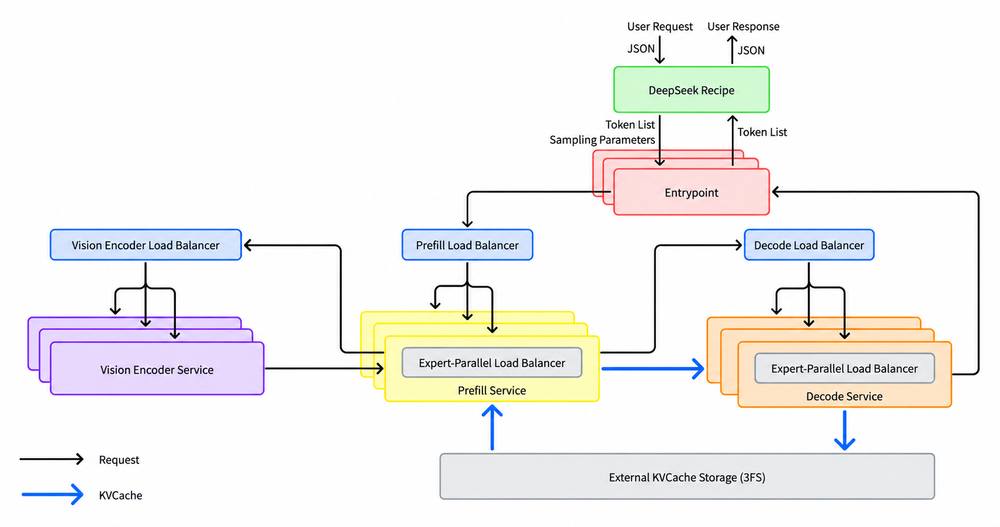
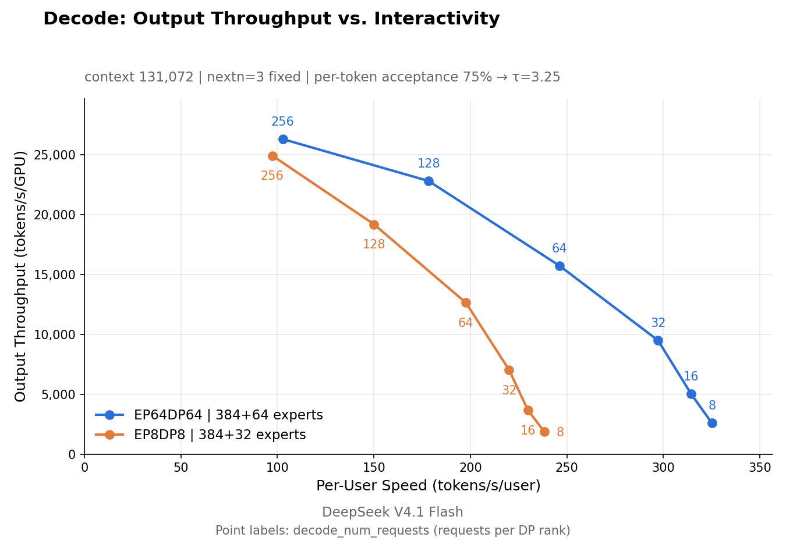
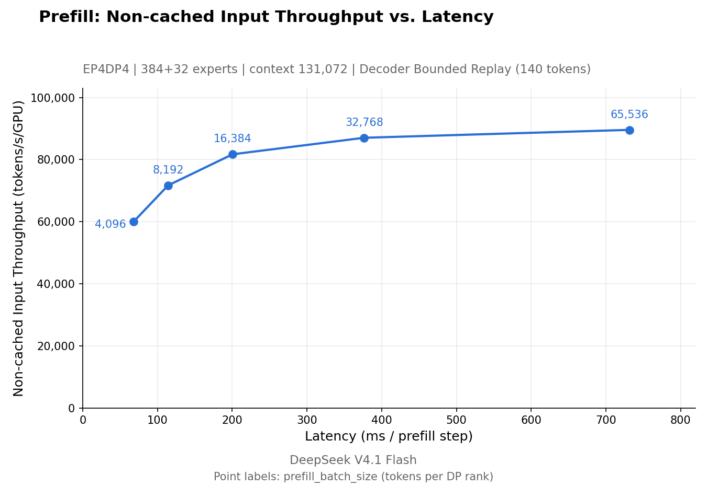
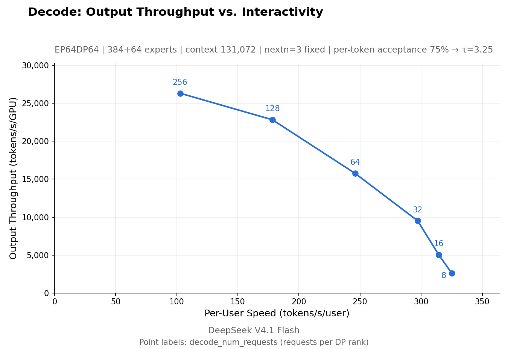

# DeepInfer 技术报告 · 分模块整理

> **原文**：[DeepSeek V4.1 Flash 大规模推理部署实践](https://zhuanlan.zhihu.com/p/2095560295930508953)（知乎，2026-10-20）
> **开源**：[deepseek-ai/DeepInfer](https://github.com/deepseek-ai/DeepInfer)（Apache-2.0）、[deepseek-ai/deepseek-recipe](https://github.com/deepseek-ai/deepseek-recipe)（MIT）
> **配套**：[DeepInfer 部署 Q&A](https://github.com/deepseek-ai/DeepInfer/blob/main/doc/inference_deployment_qa.md)（官方英文补充，持续更新）
> **整理**：2026-10-20，开源首日。原文与 Q&A 已存档至本目录（`deepinfer-zhihu-clean.md`、`deepinfer-deployment-qa.md`）；数据口径与存疑处见第 12 节。
> **来源约定**：除特别标注外，系统设计与线上数据均来自 [1]（技术报告）与 [3]（官方 Q&A）；仓库结构、构建方式与许可来自 [2][4]；模型架构与背景概念见 [5][9][12]。

**目录**

- [0. 速览](#0-速览)
- [1. 总体架构：一条请求的旅程](#1-总体架构一条请求的旅程)
- [2. 接入层：DeepSeek Recipe](#2-接入层deepseek-recipe)
- [3. 调度层：四类负载均衡](#3-调度层四类负载均衡)
- [4. 存储层：KVCache Storage](#4-存储层kvcache-storage)
- [5. 计算层之一：SWA Bounded Replay](#5-计算层之一swa-bounded-replay)
- [6. 计算层之二：DSpark 投机解码](#6-计算层之二dspark-投机解码)
- [7. 计算层之三：Asynchronous Scheduling（零开销批调度）](#7-计算层之三asynchronous-scheduling零开销批调度)
- [8. 计算层之四：结构化输出](#8-计算层之四结构化输出)
- [9. 计算层之五：低精度与算子](#9-计算层之五低精度与算子)
- [10. 开源版图：哪些能拿到，哪些拿不到](#10-开源版图哪些能拿到哪些拿不到)
- [11. 可迁移的七条经验](#11-可迁移的七条经验)
- [12. 数据口径与存疑](#12-数据口径与存疑)
- [13. 参考](#13-参考)
- [附录：名词表](#附录名词表)

---

## 0. 速览

一句话：DeepSeek 把「**用常见硬件、以尽可能低的单位算力成本，稳定服务超大规模流量**」拆成了三件事——**阶段解耦（E/P/D 分离）、专家并行（Wide-EP）、长生命期 KVCache**——再用四类负载均衡、一个独立的 3FS 缓存集群和一套接入层编解码组件把它们粘起来。

| 维度 | 数字 | 口径 |
| :--- | :--- | :--- |
| 单集群服务吞吐 | **155 万亿 Tokens/天** | 线上 V4.1 Flash 服务 |
| 单位经济性 | **38 美元 / 卡·小时** | 原文称「整体收入」，按谷价；不是毛利口径 |
| KVCache 保留目标 | **> 72 小时** | 实际 TTL：agent 3 天、chatbot 7 天 |
| Block KVCache 容量 | **约 100 PiB SSD** | 3FS 集群 |
| 3FS 聚合带宽 | 读 **10 TiB/s**、写 **850 GiB/s** | 峰值，针对 ~112 KiB block 随机读写优化 |
| 并行策略 | Prefill **EP2–8/DP2–8**；Decode **EP64–128/DP64–128** | 不用 TP / CP |
| 最小高效部署单元 | **64 卡 P + 64 卡 D** | P:D 约 1:1；1P+1D 也能跑 |
| 投机解码收益 | **+6%** 吞吐（线上） | 变长验证 vs 固定验证 5 个 draft |
| 负载均衡水平 | 约为完美均衡离线基准的 **80%** | 官方 Q&A |
| 硬件 | NVIDIA **SM100** / 华为 **昇腾 950** | CUDA 13 / CANN 9.2 |

原文的因果链非常清楚：**目标 → 约束 → 机制**。整理如下：

| 设计目标 | 推导出的技术决策 | 对应模块 |
| :--- | :--- | :--- |
| 兼容多厂商芯片 | 算子层双后端（CUDA / Ascend）、TileLang 写自定义 kernel | 第 9 节 |
| 用常见硬件组织 P/D | 8 卡机做 Prefill、64–128 卡超节点做 Decode；E/P/D 分离部署 | 第 1、3 节 |
| KVCache 保留 72h+ | 独立 3FS 存储集群 + SWA 有界回放替代持久化 SWA | 第 4、5 节 |

---

## 1. 总体架构：一条请求的旅程

请求路径可以按 7 步理解：

1. **协议层**：用户 JSON 请求（Chat Completions / Responses / Messages）进入 **DeepSeek Recipe**，被统一成一种 Conversation，再按模型版本渲染成 prompt、编码成 token 序列。
2. **接入层**：**Entrypoint** 拿到 token list 与采样参数，先在本地 `kvcache-store`（CHECK 角色）做**哈希链前缀匹配**，算出命中长度——这一步在路由之前，属于关键路径，藏不掉。
3. **路由层**：**Prefill Load Balancer** 按 compute-quota 把请求分给某个 Prefill 实例的某个 DP rank；多模态请求先绕道 **Vision Encoder LB / Service**。
4. **Prefill**：按时间预算反解 chunk size，做 chunked prefill；产出 Block KVCache 与 SWA KVCache。
5. **KV 落盘/传递**：Block KVCache 由 decode 实例写入 **3FS**；SWA KVCache 留在产出机器的内存里，通过 Entrypoint 的内存目录寻址。
6. **Decode**：**Decode Load Balancer** 在所有 decode 实例的所有卡之间统一路由，同时均衡「请求数」和「KVCache 总长」；decode 内部用 Wide-EP + EPLB 均衡 MoE 专家负载。
7. **返回**：token 流回到 Recipe，由跨 chunk 状态机解析成正文 / 思考 / 工具调用事件，再转成各协议的流式响应。

按层拆开，整个系统可以记为四层：

| 层 | 组件 | 核心职责 |
| :--- | :--- | :--- |
| 接入层 | DeepSeek Recipe、Entrypoint | 协议 ↔ token、前缀匹配、请求生命周期 |
| 调度层 | 四类 LB、自动扩缩容、零开销批调度器 | 把请求放到「边际代价最低」的卡上 |
| 执行层 | Vision Encoder / Prefill / Decode 实例、DSpark、SWA Replay、SO | 真正的前向计算与采样 |
| 存储层 | Block KVCache（3FS）、SWA KVCache（本机内存） | 跨请求、跨实例复用计算结果 |

### 1.1 模型侧前提：CED / CSA2 / FP4

推理系统的形态，首先由模型架构决定。V4.1-Flash 的几个设定直接解释了后文的设计（数据来自模型技术报告 [9]）：

| 模型设定 | 对推理系统的影响 |
| :--- | :--- |
| **40 层 = 20 层 encoder + 20 层 decoder**（CED，借鉴 YOCO [12]） | Prefill 只跑 encoder，Decode 才激活 decoder；每 token 激活参数 decode 16B、prefill 仅 8B |
| decoder 复用 encoder 产出的 KV | prefill 复杂度从 O(NL) 降到约 O(NL/2)，**总 prefill 计算近乎减半** |
| **全局 KV = main KV + indexer K**（CSA2：跨层 KV/索引复用 + 分层稀疏 indexer） | main KV 按 **4 层一组**共享（decoder 5 组 × 4 层、encoder 18 层分 3 组 × 6 层），落盘按共享组组织——这正是 128-token block 里的内容 |
| **每层都有 SWA**（窗口 128） | SWA KV 与序列长度无关，但需逐层维护 → 引出 SWA KVCache 与 Bounded Replay |
| FP4 main KV + FP4 专家权重 | 全局 KV 降到 **890 B/token**，约为 V4-Flash 的 1/4 |
| 1M 上下文、552B backbone（+196B Engram） | 长上下文 + 大专家数 → 必须 Wide-EP + 大容量 KVCache |

CED 的具体做法：decoder 层（l > L/2）的 global KV 不由自身 hidden 计算，而由第 L/2 层 hidden 投影（C_l = H_{L/2}W_l^{KV}、Z_l = H_{L/2}W_l^{Z}）；SWA KV 仍逐层生成，所以需要 replay 才能恢复。

一句话：**CED 把 prefill 减半、CSA2/FP4 把 KV 压到约 1/4、SWA 把局部状态变成常数**——推理系统的「P/D 分离 + 大缓存 + 有界回放」正是对这三个模型特性的工程响应。

### 1.2 并行策略

| 阶段 | 并行度 | 选择原则 |
| :--- | :--- | :--- |
| Prefill | EP2–8 / DP2–8 | 显存够的前提下，EP/DP **尽可能小**（通信省、单卡算力集中） |
| Decode | EP64–128 / DP64–128（Wide-EP） | 显卡够的前提下，EP/DP **尽可能大**（摊薄每步 MoE 权重读取） |
| Vision Encoder | 单卡 | 用可用范围内**最便宜**的卡 |

ATTN 部分沿用 V3/R1 推理系统的设定：**数据并行，且 #DP = #EP**。TP 与 CP 当前不用。这个约定是后面所有负载均衡问题的根源：DP/EP 副本之间只要负载不均，整个实例就被最慢的 rank 拖住（`moe_lb` = 最慢 rank / 均值）。

### 1.3 为什么 Decode 要 Wide-EP

MoE 解码每步是显存带宽瓶颈：EP 越大，每张卡需要读取的专家权重越少，单步显存流量越低。官方给的 EP8DP8 vs EP64DP64 对比曲线显示：

- 在**低交互性**区间（~100 tok/s/user，256 并发/rank），两者差距不大（约 26k vs 25k tok/s/GPU）；
- 在**高交互性**区间（>200 tok/s/user），EP64 的优势迅速拉开：220 tok/s/user 时约 15k vs 7k tok/s/GPU，**超过一倍**。

也就是说，Wide-EP 买到的不是峰值吞吐，而是「**在低延迟约束下仍能维持吞吐**」的能力——这正是在线服务最需要的区间。

### 1.4 线上数据与离线基准

线上统计图表在原文中（见原文 Image 2），核心数字即第 0 节表格。离线基准（可复现，`examples/sweep/run_sweep.sh`）的配置与读图结果如下。

**Prefill**（4×SM100，EP4DP4，384+32 experts，context 131,072，Decoder Bounded Replay 140 tokens）：

| prefill batch（tokens/DP rank） | 吞吐（tok/s/GPU，约） | 单步延迟（ms，约） |
| ---: | ---: | ---: |
| 4,096 | 60,000 | 75 |
| 8,192 | 71,000 | 115 |
| 16,384 | 81,000 | 200 |
| 32,768 | 86,000 | 370 |
| 65,536 | 88,000 | 730 |

**Decode**（64×SM100，EP64DP64，384+64 experts，context 131,072，nextn=3 fixed，单 token 接受率 75% → τ=3.25）：

| decode 并发（req/DP rank） | 吞吐（tok/s/GPU，约） | 单用户速度（tok/s，约） |
| ---: | ---: | ---: |
| 256 | 26,000 | 105 |
| 128 | 22,500 | 176 |
| 64 | 15,500 | 248 |
| 32 | 9,500 | 297 |
| 16 | 5,000 | 317 |
| 8 | 2,500 | 327 |

> 读图约值，仅用于理解曲线形状；精确数据请跑基准脚本。注意图中 decode 用 `nextn=3 fixed`，而线上 DSpark 默认 draft 5 + 变长验证，两者不是同一配置。

### 1.5 部署形态

- **最小单元**：1P + 1D 即可部署；实际 P:D 显卡比约 **1:1**；由于推荐 decode ≥ EP64，最小「高效」单元是 **64 卡 P + 64 卡 D**。
- **跨数据中心**：V4.1 Flash 的 KV 压缩率足够高，P/D 跨机房技术上可行（可靠性有代价）；按每 8 卡约 **400 Gbps** 互联带宽做预算。实际部署在相邻机房。
- **多模态**：EPD 分离，Vision Encoder 单卡部署。

---

## 2. 接入层：DeepSeek Recipe

### 2.1 为什么接入层值得单独优化

接入层在**每个请求的关键路径**上，且是纯 CPU 工作：协议解析、prompt 渲染、tokenize、流式解析。上下文越长，线性 tokenize 的耗时越显著，直接抬高 TTFT，并吃掉大量服务端 CPU。DeepSeek 的选择是把这一层做成**独立、可复用的 Rust 库 + Python 绑定**，而不是塞在推理引擎里。

### 2.2 多协议 → 一种 Conversation

Chat Completions、Responses、Messages 三种 API 的请求，先统一成同一种 **Conversation** 格式，共用一套模型模板与编码逻辑，再按模型版本（V4 / V4.1）生成 prompt 和 token 序列。模型输出则被解析成**事件**（正文、思考内容、工具调用……），再翻译回各协议的流式响应。请求转换、prompt 编码、输出解析全部用 Rust 实现，Python 侧只做绑定。

仓库是一个 **8 成员**的 Cargo workspace（0.2.0 / edition 2024）：`deepseek-recipe`（协议转换与输出解析）、`-core`（Conversation / 工具 / 多模态类型）、`-encoding`（V4/V4.1 渲染与 token 编码）、`-image`（OpenCV 图片预处理）、`-macros`（`prompt!` 宏）、`-python`（PyO3 绑定，包名 `deepseek_recipe`）、`encoding-decoding-demo`、`server-rs`；另有 Python 示例 `server-py`。关键 API：`ProtocolRequest::convert` → `ConversationRequest`；`PromptEncoding::{render_conversation, encode}`；`StreamProcessor` 负责流式解析。

### 2.3 Tokenizer 的两个坑与「分段并行」

**坑一：特殊 token 注入。** `<｜User｜>`、`<｜image｜>`、`</think>`、`｜DSML｜` 这些标记用于划分消息角色、思考边界和工具调用。如果用户输入、工具返回、工具参数里恰好出现同样的字符串，按普通文本编码就会有风险——模型可能把它当成控制结构。

**坑二：长文本 tokenize 的线性延迟。**

Recipe 的解法是**基于 special token 边界的匹配**：

- **输入编码**：构建 prompt 时记录「显式插入的 special token 及其位置」，编码时直接映射到对应 token ID；普通文本按基础词表编码。用户输入里的 `<｜User｜>` 只会被编成普通 token 序列，**无法通过文本注入控制 token**。
- **输出解析**：按 **token ID** 识别思考结束标记与 DSML 标签里的 special token。模型用普通 token「拼」出来的相同文本会被保留为字面内容，不会获得触发思考结束或工具调用的能力。这是「**看 ID 不看字符串**」的安全原则。
- **分段加速**：special token 的位置在构建 prompt 时已知；由 BPE 的性质，special token 之间的各段普通文本可以**独立编码**。于是跳过普通文本中的 special token 匹配与切分，**并行编码各段**，最后按原序拼接。长上下文请求的分词耗时因此显著下降。

### 2.4 跨 chunk 流式解析

推理后端按 token 粒度返回 chunk，一个 UTF-8 码点、一个 DSML 标签、一段工具参数都可能被拆到多个 chunk。Recipe 用一个**跨 chunk 状态机**处理：

- 遇到不完整 UTF-8 码点时先缓冲，补齐后再交给解析器；
- 解析器按「思考 / 正文 / 工具参数」阶段维护状态，用 **KMP** 增量匹配分隔标记；chunk 末尾只有标记的一部分时保留匹配进度，下个 chunk 继续，已确定内容立即输出，不回头重扫；
- 工具参数**边生成边转 JSON 片段**：字符串值逐段转义，数组/对象按原始 JSON 文本输出，不构造完整参数对象，省掉反复解析与序列化；长参数也能尽早返回首个片段。

### 2.5 工程要点

1. **把「安全」落在 token ID 层，而不是字符串层**——这是防注入最可靠的位置。
2. **利用格式本身的结构做并行**：special token 天然是分段点，BPE 的分段独立性让并行编码无损。
3. **接入层与推理引擎解耦**：Recipe 不依赖具体后端，调用方自己提供推理、工具执行和 HTTP 传输；官方 API 与第三方部署因此能共享同一套编解码逻辑。

---

## 3. 调度层：四类负载均衡

### 3.1 问题定义

#DP = #EP 意味着每个 DP rank 都要参与同一次集合通信；任何一张卡慢，整个实例都等它。于是「均衡」不是优化项，而是**正确性级别的要求**。官方用 `moe_lb`（最慢 rank / 均值）度量，1.09 意味着整步被最慢的卡拖长约 9%——换算成吞吐，大约损失 8%。

四类均衡器分工：

| 均衡器 | 作用对象 | 手段 |
| :--- | :--- | :--- |
| Prefill LB | Prefill 实例的 DP rank | 请求路由 + 分桶 + 单卡 chunk 预算 |
| Decode LB | 所有 decode 实例的所有卡 | 请求数 × KVCache 总长 双维度路由 |
| Vision Encoder LB | VE 机器/卡 | 按图片 patch 数选卡 |
| Expert-Parallel LB | MoE 专家 | 冗余专家 + 周期性重排 |

### 3.2 Prefill LB：四层路由 + 二次代价模型

核心思路：围绕「**注意力子层计算量**」做路由，用拟合的二次代价模型 `cost(q, c)` 来度量 compute-quota。其中 `q` = 序列中**未命中**的 token 数，`c` = 这条序列**已算完**的前缀长度。

1. **分桶**：按输入总长分 4 档（<16K / 16–64K / 64–256K / ≥256K）。每档分到的引擎台数，按该档**上一轮**的 compute-quota 需求占比动态重分。
2. **DP 组间**：引擎按各自**剩余 quota** 拉取请求。因为任何引擎都能命中任何前缀（Block KVCache 在独立存储集群），**不做前缀亲和路由**——这一点是第 4 节存储架构换来的自由。
3. **DP 组内**：一批请求给到引擎后，每来一个就分给当前 quota 负载最低的 DP rank。
4. **单卡内**：FIFO 出队，chunk size 不固定，由**时间预算反解**。每步给一个纳秒级预算，用 `cost(q, c)` 预测耗时，对 `q` 解二次方程，取「正好用完剩余预算」的最大 `q`（上限 32,768 token）。预算还会在 DP 组内做一次 **all-reduce MIN**，保证整组步调一致。

这套设计的妙处在于：**同一个代价模型贯穿四层**，从集群级分桶到单卡 chunk 切分，口径统一；而 `c`（已算前缀）进入模型，使长前缀请求不会被低估。

### 3.3 Decode LB：同时均衡两个维度

Decode 的代价由两部分决定：**每步 batch 大小**（≈ 请求数）和**注意力部分代价**（≈ KVCache 总长）。只均衡其中一个都会失衡。Decode LB 在所有 decode 实例的所有卡上统一路由，启发式规则是：

- **短请求** → 发给「并发较小、但 KVCache 总长偏大」的卡（用长 KV 的注意力余量吃掉小 batch）；
- **长请求** → 发给「KVCache 总长较小」的卡（避免注意力爆炸）。

具体算法参考 **DualPath**（SIGCOMM'26）的组内调度。

### 3.4 Vision Encoder LB

以**单台机器**为单位路由：Prefill 机器随机选一台「每卡一个 VE」的机器，再在这台机器上把图片交给**当前处理 patch 数最少**的卡。patch 数由宽高直接算出：`(width/patch_size) × (height/patch_size)`，不需要先做预处理就能估代价。

### 3.5 Expert-Parallel LB：冗余专家 + 周期重排

机制统一：每卡在常驻专家之外多放若干**冗余专家**（热门专家的副本）；统计最近 N 步各专家负载，每 M 步重排一次；专家权重在 scale-up 网络内通过 `symm_mem` 在并行组内转移。

| 阶段 | 冗余专家 | 统计窗 | 重排周期 | 实测 `moe_lb` |
| :--- | :--- | :--- | :--- | :--- |
| Prefill | 每卡 4 个起步（向上取整到 `ep_size` 倍数） | 100 步 | 1,000 步 | 1.0320（EP2/DP2）/ 1.0618（EP4/DP4） |
| Decode | 每卡 1 个起步（EP64 取整后每卡共 7 个，不含共享专家） | 1,000 步 | 10,000 步 | 1.090 |

> 官方 Q&A 给出的 prefill 数字是 1.074（EP4DP4）/ 1.045（EP2DP2），与中文原文略有出入，引用时建议注明来源。prefill 侧统计窗更短、重排更频繁，说明其专家负载变化更快，或对不均衡更敏感。

一个推测：**Decode 的 EPLB 更「懒」**（窗 1000 步、万步重排），可能是因为 decode 的专家负载分布更稳定，频繁重排的通信与抖动成本不划算。

### 3.6 自动扩缩容与容错

PD 分离后，两阶段的最优配比随流量漂移，静态配比会同时造成排队与空转。

- **扩缩容信号**：Prefill 看**未命中 token 数**，Decode 看**在算请求数**；调整有限速与上下界。
- **长尾处理**：大 EP 下长尾请求会拖住整个实例下线。Decode 实例收到下线通知后进入 **1 分钟宽限期**；到期仍未完成的请求连同其 KVCache **一次性转发**给其他实例继续 decode。
- **冗余配额**：池子里保留未占用的 ready 机器作扩容库存；且永远比计算出的需求多留实例——**配额占用率 > 0.8 时禁止缩容**。
- **容错**：重启是分钟级，所以不靠「缩短重启」而靠「**配额冗余 + 请求级重路由**」。大 EP 实例的全部卡是一个通信域，**一张卡坏 = 整个实例不可用**；重启时平台按当前所有健康卡**重新确定 EP size**，实例以实际拿到的卡数作为 EP 规模——把「坏卡」转化成「更小的 EP」，而不是等整机恢复。

### 3.7 效果与边界

官方 Q&A：整体负载均衡水平约为**完美均衡离线基准的 80%**。剩余 20% 的差距，推测主要来自请求到达的随机性、长尾、以及重排/迁移本身的成本。这也解释了为什么系统要保留「冗余配额」：均衡做得再好，也吸收不了突发。

---

## 4. 存储层：KVCache Storage

### 4.1 两类 KV，三种介质

V4.1 Flash 的 KVCache 分两类，生命期完全不同：

| 内容 | 介质 | 副本 | 管理方 |
| :--- | :--- | :--- | :--- |
| 运行中的 Block KV + State KV | 推理卡 HBM | — | P/D 实例 |
| SWA KVCache | 产出机器的**本机内存** | 单副本，3FS 上没有 | P/D 实例；跨机命中走 400G VLAN 拉取 |
| 分页 Block KVCache | 独立 **3FS** 集群 | 应用层无副本，靠 3FS 自身冗余 | kvcache-store |

关键判断：**Block KVCache 是「天级」数据，SWA 是「分钟级」数据，用不同介质承载**。

### 4.2 Block KVCache：为什么放在独立 3FS 集群

Block KVCache 以 **128 token** 为一个 block 分页管理（代码里的 `KVSTORE_GRAIN = 128`）。按模型架构，全局分支只存 **main KV（512 通道 latent）+ indexer K**；main KV 以 **4 层为一组共享**——decoder 20 层分 5 组（第 1 组首层 Full、其余 4 组首层 Reindex，每组其余 3 层 Reuse），encoder 的 18 个全局层分 3 组 × 6 层。博文「存储 4 层 main KV」可理解为这一 4 层粒度的分组组织，具体层数口径以博文为准。indexer 为 32 个 query head、head dim 128、top-k=512，indexer K 由 main KV 的 pre-RoPE latent 投影得到。它**不落本机内存**，而是放在独立 3FS 集群，理由有三：

1. **任何 Prefill 机器都能命中任何前缀** → 路由不需要前缀亲和，负载均衡策略与前缀亲和不再冲突（这是 3.2 节「不做前缀亲和」的前提）。
2. **存储与计算扩缩容解耦**：存储节点按容量扩，计算节点按流量扩，互不牵制。
3. **故障隔离**：计算节点故障率比存储节点高一个数量级以上，缓存不随计算节点故障而丢失。

### 4.3 容量、TTL 与带宽

- 3FS 提供约 **100 PiB** SSD 给 KVCache。
- TTL：**agent 流量 3 天，chatbot 流量 7 天**。Chatbot 长尾更重——少量 KVCache 被极多次读取，丢了对整体命中率伤害大。经验值：TTL 从 7 天缩到 3 天，chatbot 命中率下降 **0.5%–1%**。
- 带宽：针对 KVCache block 粒度（约 **112 KiB**）的随机读写优化，峰值聚合读 **10 TiB/s**、写约 **850 GiB/s**。
- 容量规划：约 **14.4 TB / GPU**（逻辑大小），物理容量更大；单存储服务器推荐 **20 × 30.73 TB SSD**，读 ≥ 40 GB/s、写 ≥ 5 GB/s，容量按保留 24 小时数据起算，再随推理规模横向扩。

### 4.4 命中路径：三段，只有第一段在关键路径上

| 段 | 做什么 | 在哪里 | 是否可掩盖 |
| :--- | :--- | :--- | :--- |
| **匹配** | Entrypoint 对本地 `kvcache-store`（CHECK 角色）做哈希链前缀匹配，只查元数据 | 本机 | **不可**——命中长度必须在路由前算出 |
| **取 KV** | 从 3FS 搬到宿主机 shm | 独立进程，异步 | 可 |
| **换入** | 从 shm 搬到 HBM | engine 进程内线程 | 可与前向重叠 |

换入用 **GDR**（GPUDirect RDMA）而不是 CUDA copy engine：KVCache block 拷贝粒度太细，copy engine 性能不佳；用 RDMA 网卡可以直接打满 PCIe 带宽，且**不占 SM**。目标是逐层 H2D 与前向计算重叠。

> 工程含义：**把「必须串行」的部分压到最小**。匹配只查元数据、取 KV 异步、换入逐层重叠——三段里两段被藏掉，只剩「算命中长度」这一段暴露在 TTFT 上。

### 4.5 SWA KVCache：分钟级数据留在本机

SWA（Sliding Window Attention）KV 不落 3FS，而是留在**产生它的那台机器的内存**里。寻址靠一个「逻辑统一、物理按 key 分散在各 Entrypoint」的**内存目录**；本机没有就跨机（400G VLAN）取回。

存储布局（官方 Q&A）：每条序列一个固定大小的 `StateBlock`，按「是否需要存」切成两段：

- **stored region**：需要跨请求保留的 SWA 窗口（V4.1 是**前 20 层**）；
- **dropped region**：YOCO consumer 层的 SWA（恢复靠 prefill 重算），以及 C2 压缩边界累加器 `ca_state` / `ica_state`（压缩窗口边界天然对齐 128 的倍数，无跨边界依赖）。

每序列只存 **20 层 × 134 token × 528 B = 1,415,040 B**。528 B/token 是 MXFP8 的 SWA KV 格式（512 通道 × 1 B + 16 个 per-32 scale）。**134 = 窗口 128 + 投机回退 6**：代码里 `DEEPINFER_MAX_BACKTRACKING_TOKENS = max(raw, DEEPINFER_USE_NEXTN_DECODE + 1)`，NEXTN 默认 5，故为 6（见 `deepinfer/environ.py`）。多出的 6 个位置用来吸收「拷贝位置最多越过 128 边界 5 个 token」的溢出。

**写入时机**（保证 128 对齐）：

- Prefill 结束后：末尾留 1 个 token 再向下对齐到 128；不足一个 128 单位则本轮不存；chunked prefill 只在**最后一个 chunk** 存。
- Decode：在显存另开副本区，每跨过一个 128 边界，把当前窗口拷进副本区；请求结束时从**最近一次完成拷贝**的位置写入存储，附着点向下对齐 128。

**效果**：SWA 只在会话内的分钟级窗口复用，池子小但周转快。线上 TTL 约 **180 秒**，命中率 **> 98%**。未命中不靠持久化，靠第 5 节的 **SWA Bounded Replay** 重算。

### 4.6 命中策略：L−134 与「退一块」

原则：**命中长度由 Block KVCache 决定；最后一个 block 要不要重算，由 SWA KVCache 决定。**

具体地，按 YOCO 截断要求，输入长度 `L` 的最大命中长度不超过 **L − 134**（128 窗口 + 6 投机回退）。在此上限内：

1. 先查 Block KVCache，得到命中长度 `L1`（128 的整数倍）；
2. 再查 SWA KVCache：若 `[L1−128, L1]` 区间内存在 SWA，命中 `L1`；否则**退一块**，命中 `L1−128`，多出的 128 作为重算窗口。

这条策略把两类缓存的「存在性」解耦：Block 决定「能复用多少」，SWA 决定「最后一块是否可信」。

### 4.7 3FS 的工程参数

- **纠删码 10+2**：每个 EC 组容忍 **2 个节点同时故障**；
- 读取时**同时向组内 11 个 Storage 节点发请求，任意 10 个响应即可解码**（用带宽换尾延迟）；
- **GC Worker**：每个 Storage 节点一个实例，按 **LRU** 周期淘汰最久未访问的 KVCache，把磁盘占用压在水位线以下；
- 注意：`kvcache-store` 侧**没有过期逻辑**，回收完全交给 3FS 自身 GC。

### 4.8 设计要点

1. **用独立存储集群换路由自由度**：多级本地缓存会迫使系统做前缀亲和，而前缀亲和与负载均衡天然冲突。DeepSeek 选择「牺牲一点读带宽，换全局任意命中」。
2. **按生命期选介质**：把分钟级的 SWA 放进天级的 SSD 池，等于用最贵的容量存最不值钱的数据——这是 V4 遗留问题，V4.1 专门改掉（见下节）。
3. **把关键路径压到一段**：匹配只查元数据；取 KV、换入都异步/重叠。

---

## 5. 计算层之一：SWA Bounded Replay

### 5.1 V4 的精确重算为什么被放弃

V4 的做法是「**落盘 + 精确重算**」：SWA KVCache 在两个位置写入持久化存储，未命中时重算「层数 × 窗口」个 token 做完整前向，逐层精确恢复窗口状态。

代价很高：

- 重算量随层数与上下文增长，不是常数；
- 为了把未命中率压到极低，必须给足 SSD 容量——**SWA 占掉持久 KVCache 近一半容量**；
- 收益却不成比例：Block 是长尾复用（一段前缀可以数天内反复命中），SWA 只在活跃会话内分钟级复用，会话结束或进入下一轮就失效。**用数天留存的容量承载分钟级生命期的数据**，在多轮短对话场景尤其不划算。

V4 技术报告里提过 **Zero SWA Caching**（完全不落盘、只靠精确重算），但生产上代价过高，V4.1 没有采用。

### 5.2 有界回放：把代价变成常数

V4.1 改为**只重算最近 128 个 token**，并把注意力窗口**截断在重算段内**：从位置 `s` 起回放，位置 `i` 的 query 只与 `[max(s, i−127), i]` 的 key 计算，得到**近似**的 SWA KVCache。

于是重算代价降为**与上下文长度、层数无关的常数**——这是整个 V4.1 KVCache 设计里最关键的一步交换：**用「近似」换「常数代价」**。模型技术报告给出的结果是：persistent KV 占用降到 V4-Flash 的约 **1/8**。

### 5.3 两处落地

| 位置 | 问题 | 做法 | 收益 |
| :--- | :--- | :--- | :--- |
| **Encoder SWA Bounded Replay** | 前缀命中长度原本受 SWA 缺失牵制 | SWA 缺失时，重算命中前缀的**最后 128 token**，与未命中后缀一起前向；重算段**只重建 SWA**，Block 原样复用、不重算不覆写 | 前缀命中长度只依赖 Block KVCache，命中率更稳 |
| **Decoder SWA Bounded Replay** | CED 架构下，decoder 层 Block KV 由 encoder 末层 hidden state 投影得到，只有 decoder SWA 需各层自算；精确重建要 20 个 decoder 层跑最后 2560 个 token（20 × 128） | 每次 prefill 在 decoder 层只重算 prompt **末尾 128 token**，产出**仅供 decode、不进前缀缓存** | **总 prefill 计算量近乎减半** |

### 5.4 取舍

- 换来的是**常数级重算**和**更简单的缓存层次**（SWA 完全不落盘）；
- 付出的是**近似误差**：SWA 窗口边界处的注意力与精确值有偏差。官方用「窗口截断在重算段内」保证误差不扩散；
- 这条路径成立的前提是 **Block KVCache 命中率足够高**——否则每次都要重算长前缀，省下的 SWA 存储又赔回去。所以它和 3FS 大容量缓存是**一对绑定的设计**。

---

## 6. 计算层之二：DSpark 投机解码

### 6.1 算法要点

DSpark 是 DeepSeek 的投机解码框架。相比 DFlash，它在输出的 base logits 上叠加一个**只依赖前一个 token id 的低秩 logit bias**，用极轻量的串行修正补回相邻 token 的局部条件化信息，提升 draft 准确率。

### 6.2 变长验证：把验证算力给「最可能被接受」的 token

不同请求、不同位置的 draft token 接受概率不同，**固定长度验证会把算力浪费在低概率 token 上**。DSpark 用 **Confidence Head** 预测每个 draft token 的接受率，调度时按「边际收益」分配验证算力：

- 线上 draft 一次生成 **5 个** token；
- 根据 profile 出的硬件吞吐曲线 + 每个请求每个 draft token 的接受率，按预期接受率排序，选**有效吞吐最大的前缀子集**验证；
- 相比固定验证 5 个，线上吞吐 **+6%**。

官方 Q&A 的离线数据更细：变长验证把每步验证的 draft 数从 **5.00 降到 3.2–4.4**，平均接受长度基本不变（**3.29 vs 3.20**），在 EP64/DP64、约 60 并发/rank 的生产工作点折合 **+4–7%** 吞吐。

| 并发（seqs/rank） | 固定 5 验证长度 | 变长验证长度 | 固定 5 接受长度 | 变长接受长度 | 变长增益 |
| ---: | ---: | ---: | ---: | ---: | ---: |
| 16 | 5 | 4.44 | 3.32 | 3.24 | −1.5% |
| 32 | 5 | 3.65 | 3.25 | 3.17 | +1.6% |
| 48 | 5 | 3.94 | 3.30 | 3.26 | +3.6% |
| 60 | 5 | 3.58 | 3.30 | 3.21 | +5.4% |
| 72 | 5 | 3.24 | 3.29 | 3.12 | +6.7% |
| 96 | 5 | 3.24 | 3.30 | 3.15 | +11.0% |

注意低并发（16）时变长验证反而略亏——**验证的固定开销**在 batch 太小时摊不掉。这也是为什么它是「在线调度策略」而不是「离线固定配置」。

### 6.3 与异步调度的冲突及解法

异步调度下，`schedule(N+1)` 执行时，第 N 步的 confidence **还没回传**。CPU 无法提前决定每个请求验证几个 token。

解法是把「未知量」下沉到 GPU：

- CPU 调度时只确定**总预算**；
- 逐请求的验证长度在 GPU 上由一个 **TileLang kernel** 重算：累乘、全局排序取 top-k、融合 remap scatter；
- 结果写回 **pinned buffer**，供下一步调度读取。

这是「**CPU 只做与数据无关的决策，数据相关的决策交给 GPU**」的典型分工。

---

## 7. 计算层之三：Asynchronous Scheduling（零开销批调度）

### 7.1 问题

Decode 第 N 步是：`schedule(N) → forward(N) → sample(N) → post-process(N)`。其中 schedule 与 post-process 是纯 CPU 逻辑；而 post-process(N) 之前必须 **GPU–CPU 同步**拿到 sample(N) 的结果。于是 post-process(N) 和 schedule(N+1) 期间，**GPU 空闲**。

### 7.2 方案

参考 SGLang、NanoFlow 的做法，把 CPU 与 GPU 的流水线错开一步：

- GPU 执行 `forward(N) → sample(N)`；
- 同时 CPU 执行 `schedule(N+1) → launch_forward(N+1) → post-process(N−1) → launch_sample(N+1)`；
- 结果：GPU 全程无空闲，调度开销被「藏」进计算里。

### 7.3 前提与代价

- 需要 **pinned buffer** 传递跨步状态，且状态机要能容忍「post-process 延迟一步」；
- 停止条件、采样参数的更新必须**可预测**（或推迟一步生效），否则会改变语义；
- 与 DSpark 的变长验证强耦合：验证长度必须在 GPU 上算（见 6.3）；
- 本质是**用流水线深度换吞吐**，代价是尾延迟与实现复杂度。

---

## 8. 计算层之四：结构化输出

### 8.1 编译 / 运行解耦

结构化输出（SO）约束模型输出严格符合 JSON Schema、正则、EBNF 等格式。DeepSeek 把它拆成两个阶段：

- **编译阶段**（独立 SO 机器）：把格式约束编译成**语法自动机**；编译与推理解耦、异步进行，请求进入 engine 前取回编译结果。
- **运行时**：每步 decode 推进自动机，确定**合法 token 集合**，生成 mask 作用于采样逻辑，强制输出符合目标结构。

### 8.2 与 Recipe 的分工

Recipe 只负责把请求里的 `response_format` / `text.format` 转成 `OutputConstraint`（JSON、JSON Schema、正则，或带工具时的工具调用块），**是否真正做 constrained decoding 由后端决定**。DeepInfer 侧则用自动机 + mask 落实。这个分层让「协议适配」与「约束执行」可以独立演进。

---

## 9. 计算层之五：低精度与算子

### 9.1 FP4 用在哪

| 对象 | 量化粒度 | 格式 |
| :--- | :--- | :--- |
| Main KV | per-16 | E2M1 + 每 16 通道 1 个 E4M3 scale（NVFP4 去掉第二级 global scale），**RoPE 之后**量化 |
| Indexer KV | per-32 | ue8m0，MXFP4 |
| SWA KV | — | 保留 FP8（MXFP8） |
| MoE routed-expert 权重 | per-32 | ue8m0，MXFP4 |

main KV 敢用 FP4 的依据是 512 通道 latent 的量级：理论上限 √512 ≈ 22.6、实测约 10，相对 FP4（E2M1 + per-16 E4M3 scale）的可表示范围有充足余量；SWA KV 则保留 FP8（MXFP8）。KV 与专家权重都走低精度，是 V4.1 能把全局 KV 压到 890 B/token、把 Wide-EP 推到 64–128 卡的前提。

### 9.2 算子栈

- 复用开源算子库：**FlashMLA、DeepGEMM、DeepEP、TileKernels、DeepSelect**；
- 自定义算子用 **TileLang** 写在 `deepinfer/model_executor/layers/tilelang_ops/{cuda,asc}`，CUDA 与 Ascend 两套实现一一对应；
- **Mega MoE** 是 scale-up 域内的通用解：不论 EP size 或 batch size，融合版都显著快于未融合版。

### 9.3 开源版 vs 内部版

官方 Q&A 承认：内部 kernel 库与开源版「大体相同」，indexer 与 mega 系列略有差异；**FlashMLA 少一个手调 SASS 优化，decode kernel 慢 5%–10%**；端到端差距**最多 5%**。这给社区一个明确预期：开源版不是「阉割版」，但也不是逐行等同。

---

## 10. 开源版图：哪些能拿到，哪些拿不到

### 10.1 模块状态

| 模块 | 是否开源 | 位置 / 说明 |
| :--- | :--- | :--- |
| 模型执行、调度引擎 | ✅ | `deepinfer/engine`、`deepinfer/worker`、`csrc/engine` |
| 算子（CUDA / Ascend） | ✅ | `tilelang_ops/{cuda,asc}` + vendor 子模块 |
| EPLB 策略 | ✅ | `deepinfer/model_executor/eplb` |
| 结构化输出 | ✅ | `deepinfer/structure_output` |
| Vision Encoder | ✅ | `deepinfer/ve` |
| Recipe 编解码 | ✅（独立仓库） | deepseek-recipe，MIT |
| **KVCache 管理系统** | ❌ 未完整开源 | 与内部基础设施耦合 |
| **负载均衡组件** | ❌ 未完整开源 | 同上 |
| **VE/P/D 分离部署** | ⚠️ 引擎功能大部分已实现 | 未随仓库提供完整部署编排 |
| **DP 副本间负载均衡** | ❌ | README 明确列为「完整服务所需但未包含」 |

README 的定位说得很清楚：这次发布的是 **offline inference**（离线推理），带「服务化所需的核心能力」，但不是一套开箱即用的在线服务。这解释了为什么第 3、4 节那么多细节只能从博文和 Q&A 里读——**代码没给，设计给了**。

### 10.2 代码导航

| 想看什么 | 入口文件 |
| :--- | :--- |
| CED / YOCO 的 prefill 截断与 consumer 层 | `deepinfer/model_executor/models/v4_modules/yoco.py`（`is_yoco_consumer_layer`、`compact_yoco_boundary`） |
| CSA2 压缩、main KV 落盘、indexer K 投影 | `deepinfer/model_executor/models/v4_modules/compress.py`（`Compressor`、`KProject`、`fused_norm_rope_hadamard_cast_store_kvcache`） |
| 层内 Full / Reindex / Reuse 调度 | `deepinfer/model_executor/models/v4_modules/attn.py`（`_store_yoco_full_kv`、`_prepare_prefill_kv`） |
| 稀疏 indexer 的 top-k 与候选块 | `deepinfer/model_executor/models/v4_modules/index_attn.py`（`MQA`、`store_index_kv`、`_topk_candidate_block`） |
| KV 内存布局、128 落盘粒度、SWA 槽位 | `deepinfer/worker/cache_engine.py`（`KVSTORE_GRAIN`、`get_inference_swa_block_size`） |
| DSpark 变长验证调度 | `csrc/engine/mtp_varlen.hpp`（`MTPVarlen::schedule`） |
| 异步调度（ZOS）输入准备 | `csrc/engine/zos.cpp`（`prepare_decode_zos_inputs`、`update_metadata_for_sampling_zos`） |
| SWA 索引展开（bounded replay 的窗口截断） | `deepinfer/model_executor/layers/tilelang_ops/swa_index.py`（`expand_swa_index`） |

> 说明：上表是「概念 → 文件」的导航，不保证覆盖全部实现；行号会随仓库更新变化，引用时以函数名为准。

### 10.3 快速开始

~~~bash
# NVIDIA；Ascend 用 DEEPINFER_ACCELERATOR=ascend
export DEEPINFER_ACCELERATOR=nvidia
./build.sh
python examples/offline_inference.py
~~~

- 依赖：Linux、GCC ≥ 13、Python 3.12、CUDA 13（NVIDIA）/ CANN 9.2（Ascend）。
- 默认 checkpoint：`deepseek-ai/DeepSeek-V4.1-Flash-1017`；可用 `DEEPINFER_HF_MODEL_DIR` 指向本地副本。
- 评测：`eval/README.md`。AIME 2026（30 题 × 32 采样）、GPQA Diamond（198 题 × 8）、HLE（2500 题），指标 Pass@1；生成与打分分离，默认 LLM judge。仓库参考值 AIME 99.9 / GPQA 93.4 / HLE-Full 42.6（自称 indicative，对应 `-1017` checkpoint），**不要与模型报告表 3 混用**。
- Recipe：`pip install deepseek-recipe`，或 `cargo add deepseek-recipe@0.2 deepseek-recipe-encoding@0.2`。

### 10.4 许可

- **DeepInfer：Apache-2.0**（专利授权友好，适合商业部署）。
- **deepseek-recipe：MIT**（更宽松，便于嵌入各类服务）。

两个仓库许可不同，商用前注意区分。

---

## 11. 可迁移的七条经验

1. **先定部署约束，再谈优化**：8 卡 P、64–128 卡 D、常见硬件——所有 kernel 与调度决策都是在这个约束下推出来的，不是「先做通用框架再适配」。
2. **用存储架构换路由自由度**：独立 3FS 集群让「任意前缀可命中」，才敢做无亲和路由；多级本地缓存看似省带宽，实则把系统锁进前缀亲和。
3. **按数据生命期分层**：分钟级的 SWA 不配占用天级的 SSD；把它赶回本机内存，再用常数代价重算兜底。
4. **近似 > 精确，当近似是常数代价时**：SWA Bounded Replay 用 128 token 的近似重算，换掉了「层数 × 窗口」的精确重算，且误差被窗口截断控制住。
5. **关键路径只留不可掩盖的一段**：KV 命中路径三段，只有「算命中长度」暴露在 TTFT 上；其余异步或逐层重叠。
6. **调度与计算重叠时，把数据相关决策下沉到 GPU**：DSpark 的验证长度、变长 draft 的 top-k，全部在 GPU kernel 里算，CPU 只定预算。
7. **用冗余换可用性，而不是缩短故障恢复**：配额冗余 + 请求级重路由 + 按健康卡重定 EP，比追求「分钟级重启变秒级」更现实。

---

## 12. 数据口径与存疑

整理时发现几处需要留意的口径问题，引用时建议核对原始来源：

1. **`moe_lb` 两处不一致**：中文博文为 1.0320（EP2/DP2）/ 1.0618（EP4/DP4）；官方英文 Q&A 为 1.045（EP2DP2）/ 1.074（EP4DP4）。本文正文采用博文数字，并在表下注明 Q&A 版本。
2. **38 美元/卡·小时**：原文明确是「整体**收入**」，按谷价；不是毛利，也不是成本。部分二手报道写成「毛利」，属于误读。
3. **155 万亿 Tokens/天**：单一集群口径；不代表全网或单模型。
4. **图表配置 ≠ 线上配置**：离线 decode 基准用 `nextn=3 fixed`，线上 DSpark 用 draft 5 + 变长验证；两者吞吐不可直接对比。
5. **线上统计图未能存档**：原文 Image 2 为防盗链图片，本目录未保存；第 0 节数字来自正文与 Q&A。
6. **未开源模块的描述无法代码验证**：KVCache 管理、四类 LB 的实现细节来自博文与 Q&A，仓库中没有对应代码。
7. **Benchmark 数字为读图约值**：见 1.4 节表注；精确值以 `run_sweep.sh` 复现为准。
8. **3FS 带宽口径**：博文称峰值聚合读 10 TiB/s、写 850 GiB/s；3FS README 给的单集群（180 存储节点）读带宽约 6.6 TiB/s。两者可能是「峰值 vs 实测」「不同集群规模」的差异，引用时注明来源。
9. **评测数字分两套**：模型报告表 3 为 AIME 100 / GPQA 90.9 / HLE 36.8（39.1†）；仓库 `eval/README.md` 的参考值是 AIME 99.9 / GPQA 93.4 / HLE-Full 42.6（自称 indicative），对应更新的 `DeepSeek-V4.1-Flash-1017` checkpoint。**两套数不可互换**。
10. **134 与 2560 的出处**：模型报告只给 n_win = 128 与 L/2 × n_win 的公式；134 = 128 + 6 是部署常量（6 来自 NEXTN+1），2560 = 20 × 128 是 decoder 侧精确重建量，均来自 DeepInfer 文档/代码而非论文正文。

---

## 13. 参考

1. DeepSeek-AI.《DeepSeek V4.1 Flash 大规模推理部署实践》. 知乎, 2026-10-20. <https://zhuanlan.zhihu.com/p/2095560295930508953>
2. DeepSeek-AI. DeepInfer. GitHub. <https://github.com/deepseek-ai/DeepInfer>
3. DeepSeek-AI. DeepInfer Inference Deployment Q&A. <https://github.com/deepseek-ai/DeepInfer/blob/main/doc/inference_deployment_qa.md>
4. DeepSeek-AI. deepseek-recipe. GitHub. <https://github.com/deepseek-ai/deepseek-recipe>
5. DeepSeek-AI. 3FS. GitHub. <https://github.com/deepseek-ai/3FS>
6. X. Cheng et al. *DSpark: Confidence-Scheduled Speculative Decoding with Semi-Autoregressive Generation*. arXiv:2607.05147, 2026.
7. Y. Wu et al. *DualPath: Accelerating Agentic LLM Inference by Harvesting Disaggregated KV-Cache Storage I/O*. SIGCOMM '26, 2026.
8. DeepSeek-AI.《DeepSeek-V3/R1 推理系统概览》. 知乎. <https://zhuanlan.zhihu.com/p/27181462601>
9. DeepSeek-AI. *DeepSeek-V4.1-Flash: Pushing the Limits of KV Cache Compression*. arXiv:2609.19969, 2026. <https://arxiv.org/abs/2609.19969>
10. L. Zheng et al. *SGLang: Efficient Execution of Structured Language Model Programs*. NeurIPS 2024.
11. K. Zhu et al. *NanoFlow: Towards Optimal Large Language Model Serving Throughput*. OSDI '25.
12. Y. Sun et al. *You Only Cache Once: Decoder-Decoder Architectures for Language Models*. NeurIPS 37, 2024, pp. 7339–7361.

---

## 附录：名词表

| 术语 | 含义 |
| :--- | :--- |
| **TTFT / TBT** | Time To First Token / Time Between Tokens；分别对应 Prefill 与 Decode 的延迟指标 |
| **EP / DP** | Expert Parallel / Data Parallel；本文中 #DP = #EP，ATTN 走 DP、MoE 走 EP |
| **Wide-EP** | Decode 阶段用 64–128 卡的大规模专家并行，摊薄每步专家权重读取 |
| **EPLB** | Expert-Parallel Load Balancer，冗余专家 + 周期重排 |
| **`moe_lb`** | 最慢 rank 负载 / 平均负载，越接近 1 越均衡 |
| **compute-quota** | 拟合的注意力子层计算量，本文用二次代价模型 `cost(q, c)` 表示 |
| **SWA** | Sliding Window Attention，滑动窗口注意力；窗口 128 + 投机回退 6 = 134 |
| **YOCO / CED** | V4.1 的模型架构设定；CED 下 decoder Block KV 由 encoder 末层 hidden 投影得到 |
| **DSML** | DeepSeek 的工具调用标记语言，解析依赖 `｜DSML｜` special token |
| **3FS** | DeepSeek 开源的高性能分布式文件系统，KVCache 的底层存储 |
| **EC 10+2** | 10 数据块 + 2 校验块的纠删码，容忍 2 节点同时故障 |
| **GDR** | GPUDirect RDMA，绕过 copy engine 做 H2D，不占 SM |
| **StateBlock** | SWA KVCache 的固定大小槽位，分 stored / dropped 两区 |
| **SO** | Structured Output，结构化输出；编译成语法自动机 + 采样 mask |
